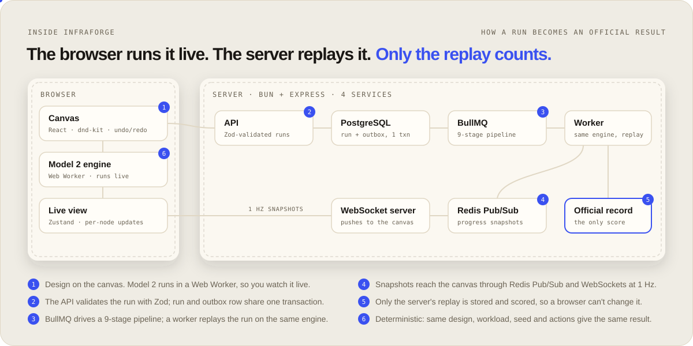
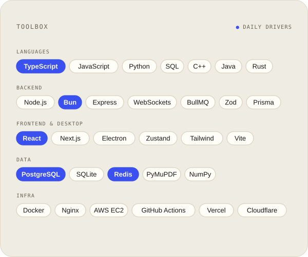
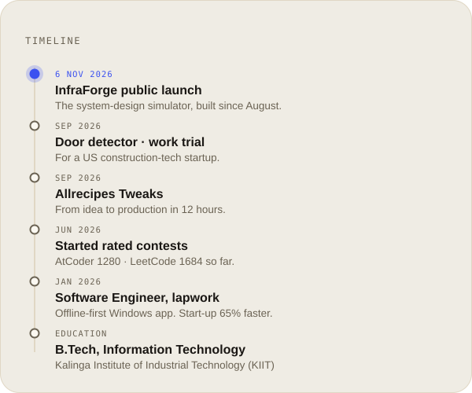
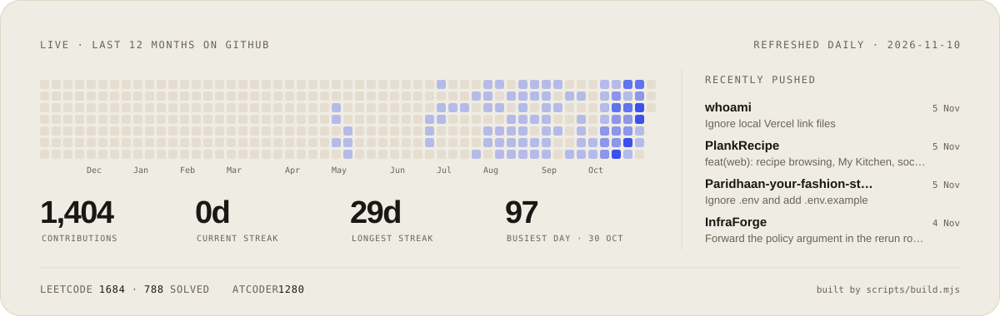

<a href="https://whoami-seven-phi.vercel.app">
  <picture>
    <source media="(prefers-color-scheme: dark)" srcset="assets/hero-dark.svg">
    
  </picture>
</a>

  <samp>
    <a href="https://whoami-seven-phi.vercel.app">portfolio</a> ·
    <a href="https://whoami-seven-phi.vercel.app/world/">3d world</a> ·
    <a href="https://www.linkedin.com/in/binaryrishabh">linkedin</a> ·
    <a href="https://leetcode.com/u/binaryrishabh/">leetcode</a> ·
    <a href="https://atcoder.jp/users/binaryrishabh">atcoder</a> ·
    <a href="mailto:srivastavarishabh2001@gmail.com">email</a>
  </samp>

**Now:** **[InfraForge](https://infraforge.lapwork.in)** launches publicly on 6 November 2026. You design a system, run it under load and faults, and watch where and why it breaks.

I'm a full-stack engineer at [lapwork](https://lapwork.in), where I build an offline-first Windows app with Electron, React and SQLite. Outside of work I build backends, LLM pipelines, and the occasional geometry problem. B.Tech IT, KIIT.

### Selected work

<a href="https://github.com/binaryrishabh/InfraForge"><picture><source media="(prefers-color-scheme: dark)" srcset="assets/cards/infraforge-dark.svg"></picture></a> <a href="https://github.com/binaryrishabh/PlankRecipe"><picture><source media="(prefers-color-scheme: dark)" srcset="assets/cards/allrecipes-dark.svg"></picture></a>
<a href="https://github.com/binaryrishabh/floorplan_cv"><picture><source media="(prefers-color-scheme: dark)" srcset="assets/cards/floorplan-dark.svg"></picture></a> <a href="https://github.com/binaryrishabh/lapwork_Windows"><picture><source media="(prefers-color-scheme: dark)" srcset="assets/cards/lapwork-dark.svg"></picture></a>

**InfraForge** [live](https://infraforge.lapwork.in) · [code](https://github.com/binaryrishabh/InfraForge) &nbsp;·&nbsp; **Allrecipes Tweaks** [live](https://allrecipes.lapwork.in) · [code](https://github.com/binaryrishabh/PlankRecipe) &nbsp;·&nbsp; **Door detector** [code](https://github.com/binaryrishabh/floorplan_cv) &nbsp;·&nbsp; **lapwork** [site](https://lapwork.in) · [code](https://github.com/binaryrishabh/lapwork_Windows) &nbsp;·&nbsp; **This portfolio** [code](https://github.com/binaryrishabh/whoami)

 

<a href="https://github.com/binaryrishabh/InfraForge"><picture><source media="(prefers-color-scheme: dark)" srcset="assets/architecture-dark.svg"></picture></a>

 

<picture><source media="(prefers-color-scheme: dark)" srcset="assets/toolbox-dark.svg"></picture> <picture><source media="(prefers-color-scheme: dark)" srcset="assets/timeline-dark.svg"></picture>

 

<a href="https://leetcode.com/u/binaryrishabh/"><picture><source media="(prefers-color-scheme: dark)" srcset="assets/cp-dark.svg"></picture></a>

 

<picture><source media="(prefers-color-scheme: dark)" srcset="assets/live-dark.svg"></picture>

 

<a href="mailto:srivastavarishabh2001@gmail.com"><picture><source media="(prefers-color-scheme: dark)" srcset="assets/footer-dark.svg"></picture></a>

Every image here is drawn by [`scripts/build.mjs`](scripts/build.mjs) with no dependencies. A [GitHub Action](.github/workflows/refresh.yml) redraws the live panels every day from the GitHub, LeetCode and AtCoder APIs.
